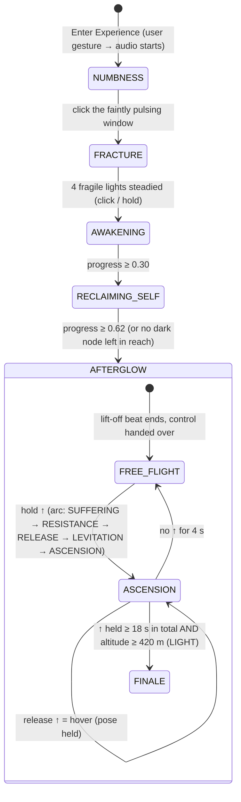

# AFTERGLOW — interactive design (v3)

## 1. State machine



ASCII version:

```
 NUMBNESS ──click pulse──► FRACTURE ──4 steadied──► AWAKENING ──P≥.30──► RECLAIMING_SELF ──P≥.62──► AFTERGLOW
                                                                                                   │
                                                          FREE_FLIGHT ◄──release ↑── ASCENSION ◄──hold ↑
                                                                                     │
                                                                          altitude ≥ 560 m → FINALE
```

Rules (`js/core/fsm.js`):

* The state changes **only** through `AG.FSM.advance(from)`, called by the interaction modules when
  the viewer completes something. Nothing is timer-driven.
* `stateTime`, `animTime` and `modeTime` exist only for animation, camera easing and sound.
* Each state opens with a short **cinematic beat** (`intro` 6.4 s, `fracture` 3.2 s, `stand` 5.2 s,
  `liftoff` 6.6 s). During a beat, input is ignored. Afterwards the camera returns to the viewer.
* `jumpTo(id)` is for presentation and testing. Skipped states complete with default choices
  (`autoComplete`), and going back resets the story.

## 2. Interaction flow

```
 ┌ NUMBNESS ────────────────────────────────────────────────────────────────┐
 │ opening beat: A lying → I pushing up → H seated (camera pulls back)      │
 │ EXPLORE: drag/arrows look · wheel zoom · hover                           │
 │ pulse window (55–125° off the first view) → hints after 10/20/34/52 s:  │
 │   brighter · edge arrow · ring · gentle camera drift · light shaft       │
 │ click it ──► 'fracture' event: impact, lightning ×3, boom, limited light │
 └──────────────────────────────────────────────────────────────────────────┘
 ┌ FRACTURE ────────────────────────────────────────────────────────────────┐
 │ beat: reverse angle, she hugs her knees (B) → back to EXPLORE            │
 │ 6 fragile lights: irregular flicker + blackouts                          │
 │ click while lit, or hold (charge ring) ──► 'stabilise': zap, glitch,     │
 │   neon flare, small lightning, a source of R 34 m at half strength       │
 │ 4 steadied ──► the pulse + steadied lights seed the NETWORK              │
 └──────────────────────────────────────────────────────────────────────────┘
 ┌ AWAKENING / RECLAIMING SELF ─────────────────────────────────────────────┐
 │ nodes: lit (colour) · dark-in-reach (cold ring) · dark-out-of-reach      │
 │ drag lit → dark in reach (≤175 m)  or click a dark node                  │
 │   ──► thread travels 0.85 s → node lights → source R 72 m (04: 118 m,    │
 │       + up to 2 neighbours cascade)                                      │
 │ hint ring on a reachable node after 9 s idle                             │
 │ RECLAIMING beat: she stands (H → J); the "still here" sign returns       │
 └──────────────────────────────────────────────────────────────────────────┘
 ┌ AFTERGLOW ───────────────────────────────────────────────────────────────┐
 │ beat: J → D rising → E levitating → flash → G flying (chase camera)      │
 │ FREE_FLIGHT: mouse x / ← → turn · ↓ descend · probe avoidance · slide    │
 │ ASCENSION ARC (hold ↑, by held seconds): B curled & sinking → C kneeling │
 │   looking up → E arms open, levitating → rising; camera in front, full  │
 │   body, orbits and pulls back; release = hover, 4 s = back to flight    │
 │ (previous: vy → 19 m/s, upright body, aura, trail beneath,)             │
 │   camera drops behind/below and tilts up, cloud + dawn grow, riser       │
 │ cloud layer (≈450 m) → crash · light threshold (560 m) → FINALE          │
 │ FINALE: E arms open, sun, title, end card (no automatic ending earlier)  │
 └──────────────────────────────────────────────────────────────────────────┘
```

## 3. The restoration algorithm (`js/core/restoration.js`)

**Field.** A 512 × 512 image (`p5.Image`, 2D canvas) covers the city's ground plane. Each viewer
action adds a **source**: `{x, z, R, dur, strength, col, t0}`. While a source grows
(`radius = R · easeOut((t−t0)/dur)`), the field is repainted:

```
clear to black
globalCompositeOperation = 'lighten'          // per channel max
for each source: radial gradient, colour = col × strength, flat to 70 % of radius, fading to 0
```

So each texel holds the brightest light that ever reached it. Restoration can only grow, and it is
order-independent. Shaders read the field with one lookup (`fieldAt(p)`):
`L = max(r, g, b)` is the amount restored, and `rgb / L` is the colour of that light. The image is
re-uploaded only on frames where a source is still growing (`setModified(true)`).

**What L drives, per fragment and per vertex.**

| Effect | Where | Mapping |
|---|---|---|
| Windows ignite room by room, in the light's colour | `city.glsl` `windows()` | `onL = smoothstep(h·0.7, h·0.7+0.02, 1.2·L)` |
| Facade holes close | `city.glsl` `facadeDamage()` | severity `D = uDamage · susceptibility(building) · (1 − smoothstep(.06,.9,L))`; hole where noise > `1 − 0.6·D` |
| Repair lattice and gold seam | `city.glsl` | the band that *was* a hole but is not any more shows a construction lattice in the field colour, then a kintsugi seam |
| Floating fragments return | `city.glsl` vertex | `assembled = smoothstep(order, order+.18, max(uRebuild, 0.98·L))` |
| Signs and holograms power on | `neon.glsl` `power()` | `onL = smoothstep(h·.5, h·.5+.06, 1.2·L)` |
| Smoke columns thin | `renderer.drawSmoke` | density × (1 − L at the source) |

**Waves.** The 8 most recent growing sources are also sent as uniforms (`uSpot`, `uSpotC`). A bright
front then sweeps across facades as the light travels.

**Progress.**

* `Restoration.progress` samples the field at every building ≥ 22 m tall in front of her (±110°,
  ≤ 1 km), weighted by √height. It also yields the number of buildings lit and the districts
  activated (250 m cells).
* `Interactions.progress = max(field progress, 0.62 × lit nodes / (0.8 × network size))`. This
  guarantees that every procedurally generated city can reach the thresholds by connecting nodes.

**Mood.** `Story` turns state and progress into one continuous value `m`, eased over a few seconds:

| State | m |
|---|---|
| NUMBNESS | 0 |
| FRACTURE | 0.03 + 0.025 per light steadied |
| AWAKENING | 0.13 → 0.45 |
| RECLAIMING SELF | 0.45 → 0.85 |
| AFTERGLOW | 0.86 → 1 with altitude |

`m` drives rain (0.95 → drizzle 0.2 → 0), haze, smoke, embers, global damage severity (which relaxes
only after m > 0.45, so early repairs are the viewer's own), global window light, neon and holograms,
traffic, sky, grade, music filter and ambience. Nothing switches abruptly.

## 4. p5.js / JavaScript functions used

**p5.js (instance mode, WEBGL2):**

* setup and canvas: `new p5()`, `setup`, `draw`, `windowResized`, `createCanvas(…, WEBGL)`,
  `setAttributes`, `resizeCanvas`, `pixelDensity`, `frameRate`, `deltaTime`, `noLoop`
* shaders and geometry: `createShader`, `shader`, `setUniform`, `model`, `p5.Geometry` (via
  `GeometryBuilder`), `freeGeometry`
* images and framebuffers: `createFramebuffer` (`HALF_FLOAT`, `begin` / `end`, `resize`,
  `loadPixels`), `createGraphics`, `createImage`, `p5.Image.get`, `setModified`, `loadImage`
* drawing state: `blendMode` (`BLEND`, `ADD`), `noStroke`, `background`, `clear`, `drawingContext`
  (raw WebGL2 depth and blend state)

**JavaScript and Web APIs:**

* Web Audio: `AudioContext`, `OscillatorNode`, `GainNode`, `BiquadFilterNode`, `ConvolverNode`,
  `DynamicsCompressorNode`, `AnalyserNode`, `StereoPannerNode`, `WaveShaperNode`,
  `MediaElementAudioSourceNode`, `AudioBufferSourceNode`, `AudioParam.setTargetAtTime`,
  `getUserMedia` (optional Voice Mode)
* Canvas 2D: `createRadialGradient`, `globalCompositeOperation = 'lighten'`, `getImageData`
* Pointer and keyboard events, with `preventDefault` on arrows and Space; `requestFullscreen`;
  `history.replaceState` (seed in the URL); `performance.now`; typed arrays (`Float32Array`) for
  uniform arrays
* GLSL ES 3.00: value noise and fbm, `fwidth` anti-aliasing, a vertex texture fetch of the field,
  structs, and `discard` for sprites

## 5. Presentation text (UTS Interactive Media)

> **AFTERGLOW — A City Made of Feelings** is an interactive cyberpunk music video rendered live in
> the browser with p5.js (WebGL 2) and the Web Audio API. A procedurally generated megacity is the
> body of a young woman's grief: it begins devastated, torn open, dark and drowned in rain. The
> story never moves on by itself. Each of five emotional states — Numbness, Fracture, Awakening,
> Reclaiming Self, Afterglow — is completed by an act of attention from the viewer: noticing one
> faint living window; steadying fragile lights that keep failing; choosing a path for light through
> the network of the city; and finally taking her flight into one's own hands and deciding to rise.
>
> The city remembers. Every action writes into a persistent restoration field that rebuilds the
> city gradually, physically and in light: wounds in facades close behind a construction lattice of
> the viewer's colour, floating fragments return with gold seams, windows ignite room by room, smoke
> thins, rain turns to drizzle, and the adaptive score opens up. Recovery is shown not as a reset but
> as a city rebuilt by choices — *she didn't rebuild the city she lost; she created a city that
> belonged to her.*

## 6. Tested features

Tested with short (≤ 60 s) headless Chromium / SwiftShader runs. GPU rendering in that environment
runs at about 1 fps, so the logic tests disable rendering, and visual tests take single frames at
small sizes.

| Feature | How it was tested | Result |
|---|---|---|
| Load, shader compilation, no page errors | load and enter; console and page errors collected | ✅ no errors |
| 01 → 02 | camera turned to the pulse, a real mouse click at its projected position | ✅ FRACTURE, beat `fracture`, pose B |
| 02 → 03 | real clicks on fragile lights while lit | ✅ 4 steadied → AWAKENING, network seeded |
| 03 → 04 → 05 | alternating real clicks on dark nodes and real drags from lit → dark | ✅ progress grows, RECLAIMING (pose J), then AFTERGLOW with the `liftoff` beat |
| Persistent restoration | field progress, buildings lit, districts, mood, rain, damage read after each step | ✅ monotonic: rain 0.95 → 0.3, damage 1 → 0.63 |
| Free flight | ← held 2 s (yaw −1.74 rad, speed 20 m/s), ↓ held (descends at −9.7 m/s) | ✅ |
| Ascension arc | ↑ held: SUFFERING (B) 0–1.4 s, RESISTANCE (B→C), RELEASE (C→E) at 3.8 s, LEVITATION at 6.2 s, ASCENSION at 12 s; release → hover (vy 0.06, pose E held); 2 s hold + release → back to flight after 4 s; LIGHT reached after 29 s of holding (≥ 18 s and 420 m) | ✅ |
| Ascension visuals | single frames: B curled in the air (front, full body), C kneeling in the stand beat, E rising above the city with the city below | ✅ |
| Finale | climbing through 560 m → `finale`, pose E, sun 1, title shown | ✅ |
| Presentation jumps and back | 1–5 / jumpTo forward (auto-complete) and back (full reset) | ✅ |
| Rendering | single frames: intro (A lying), explore (prompt, city, rain), RECLAIMING (nodes, threads, purple mood) | ✅ |
| Original graphics kept | city generator, shaders and assets are extended, not replaced; `backup_original/` included | ✅ |

## 7. Remaining limitations, and what needs a real browser test

* **Performance on real GPUs was not measured here.** The facade-damage code adds work to every
  facade fragment. The adaptive quality tiers still apply, and *Low* is the fallback.
* **Visual tuning of the damage** (hole size, rim, lattice, smoke density) was checked only at very
  small resolution. Please judge it at full screen. All the constants are in `facadeDamage()` in
  `js/shaders/city.glsl.js` and in `drawSmoke()`.
* **Network size depends on the seed** (about 15–25 visible nodes). The lit-node share in
  `Interactions.progress` keeps every seed completable.
* Facade holes are shaded cavities: interior, slabs, rebar, embers. They are not geometric cut-outs,
  so silhouettes do not change. Real geometric repair is the fragment system of the broken towers.
* Character poses B, C, E, F, G still use the provisional checkerboard-keyed cut-outs; see
  `docs/CHARACTER_ASSETS.md`. D is a duplicate of C.
* Audio was verified for wiring only. Listening to the adaptive score (section loops, ascension
  accents) and to an MP3 soundtrack (the low-pass opening with progress) needs a real browser.
* Voice Mode requires HTTPS or localhost and permission. Everything works without it.
